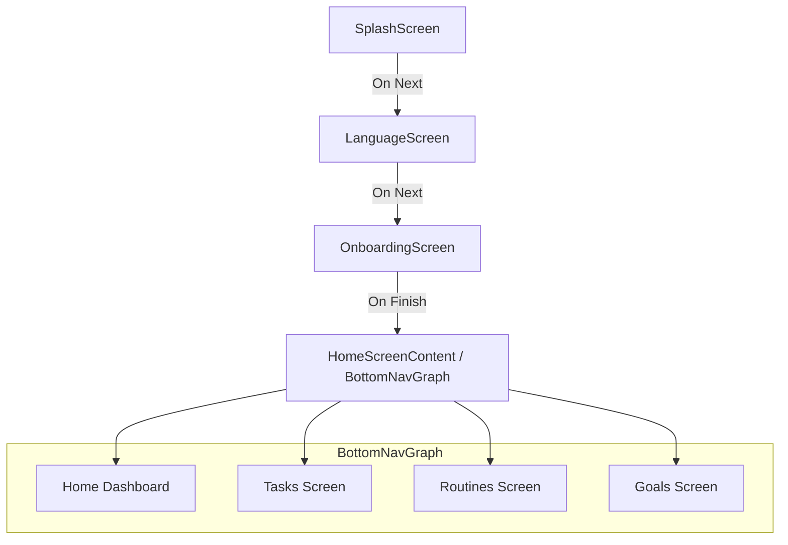

# Life Planner App - Comprehensive Deep Analysis

This document provides a 100% thorough, deep-dive analysis of the **Life Planner** Android application codebase, architecture, UI flows, features, and readiness roadmap.

---

## 1. Technical Stack & Architecture

- **Language**: Kotlin
- **UI Framework**: Jetpack Compose (Material 3)
- **Navigation**: Jetpack Navigation 3 (`androidx.navigation3.runtime`, `androidx.navigation3.ui`) with Kotlin Serialization (`kotlinx.serialization.json`)
- **Target & Compile SDK**: API 37 (Min SDK: 24)
- **Architecture Pattern**: Unidirectional Data Flow (UDF) / Compose State Management (UI layer in place; data persistence layer pending).

---

## 2. Navigation & User Flows

The app uses a dual-layer navigation architecture powered by **Jetpack Navigation 3**:

### Flow Breakdown:
1. **Splash Screen (`SplashScreen.kt`)**: Initial branded entry point.
2. **Language Screen (`LanguageScreen.kt`)**: Language selection screen (e.g., English, etc.).
3. **Onboarding Screen (`OnboardingScreen.kt`)**: Multi-step onboarding introduction.
4. **Main Home Container (`HomeScreenContent.kt`)**: Hosts the bottom navigation bar with a custom curve cutout (`BottomNavCurveShape`) and a centered Floating Action Button (FAB) on the Home tab.

---

## 3. Core Modules & Screen Breakdown

### A. Home Dashboard (`HomeDashboard.kt` & `HomeComponents.kt`)
- **Purpose**: Central hub providing daily overview, stats, quick reminders, and schedule summary.
- **Components**: Greeting header, summary cards, quick statistics widgets, recent tasks/routines overview.

### B. Tasks (`TasksScreen.kt`, `TaskComponents.kt`)
- **Purpose**: Comprehensive task management.
- **Features**: Filtering chips ("Today", "All", "Upcoming", "Completed"), task item cards with checkboxes, priority indicators, due dates, and categories.
- **Creation**: `NewTaskBottomSheet` allows adding tasks with title, category, priority, date/time pickers, notes, and repetition rules.

### C. Routines / Habits (`RoutinesScreen.kt`, `RoutineComponents.kt`)
- **Purpose**: Daily habit and routine tracking.
- **Features**: Streak counters (`LocalFireDepartment` icon), time-of-day grouping (Morning, Afternoon, Evening), completion toggles.
- **Creation**: `NewRoutineBottomSheet` allows setting routine presets, frequency, reminder settings, and notes.

### D. Goals (`GoalsScreen.kt`, `GoalComponents.kt`)
- **Purpose**: Long-term objective and milestone tracking.
- **Features**: Goal categories, progress bars, metric tracking (`TrackChanges` icon).
- **Creation**: `NewGoalBottomSheet` allows creating personal/career goals with target dates and metric targets.

### E. Utilities & Quick Add (`AddNewBottomSheet.kt`, `UtilitiesScreen.kt`)
- **Quick Add Hub (`AddNewBottomSheet.kt`)**: Central modal sheet triggered by the Home FAB, offering quick creation options for Tasks, Routines, and Goals with advanced time/date pickers.
- **Utilities (`UtilitiesScreen.kt`)**: Extra tools and productivity utilities.

---

## 4. Current Status vs. Production Readiness

> [!NOTE]
> **What is fully built**: The entire UI layer, Compose screens, navigation setup (Navigation 3), custom bottom bar with curve cutout and animated FAB, bottom sheets with intricate picker dialogs, and styling/theming (`LifePlannerTheme`).

> [!IMPORTANT]
> **What needs to be implemented (Next Steps)**:
> 1. **Data Layer (Room Database)**: Entities (`TaskEntity`, `RoutineEntity`, `GoalEntity`), DAOs, and `AppDatabase`.
> 2. **Repository & ViewModels**: Connect ViewModels (`TaskViewModel`, `RoutineViewModel`, `GoalViewModel`) to handle database operations using Kotlin Coroutines and StateFlow.
> 3. **State Integration**: Wire up the creation bottom sheets and screen lists to persist and observe real data from the database instead of local ephemeral state.
> 4. **Testing**: Add unit tests for ViewModels and Compose UI UI tests.

---

## 5. Summary Table of Files

| Component / Screen | File Path | Status |
|---|---|---|
| **Navigation** | `navigation/RootNavigationSetup.kt`, `BottomNavigationSetup.kt`, `Screen.kt`, `BottomNavScreen.kt` | Completed |
| **Home** | `ui/screens/home/HomeDashboard.kt`, `HomeComponents.kt` | Completed (UI) |
| **Tasks** | `ui/screens/tasks/TasksScreen.kt`, `TaskComponents.kt` | Completed (UI) |
| **Routines** | `ui/screens/routines/RoutinesScreen.kt`, `RoutineComponents.kt` | Completed (UI) |
| **Goals** | `ui/screens/goals/GoalsScreen.kt`, `GoalComponents.kt` | Completed (UI) |
| **Modals / Add** | `ui/screens/AddNewBottomSheet.kt` | Completed (UI) |
| **Theme** | `ui/theme/Theme.kt`, `Color.kt`, `Type.kt`, `Dimens.kt` | Completed |
